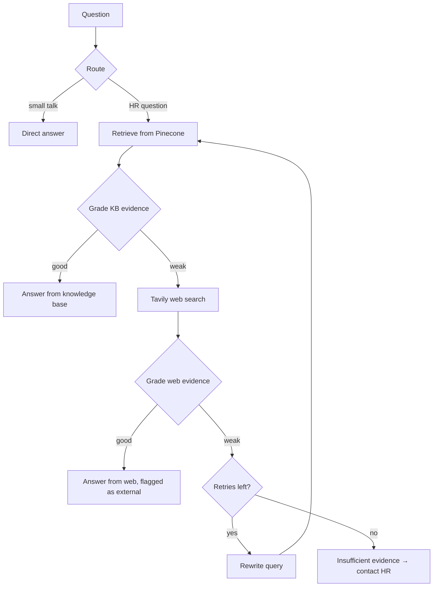

# Agentic RAG Chatbot for HR Policy & Employee Support

An HR assistant that answers employee questions from a company knowledge base, checks whether its own evidence is good enough, and falls back to web search or query rewriting when it isn't. Built with **LangGraph**, **NVIDIA NIM**, **Pinecone** and **FastAPI**, and evaluated component by component with **DeepEval**.


## Highlights

- **Agentic workflow:** a LangGraph state machine that routes, retrieves, grades evidence, searches the web, rewrites queries and retries, instead of a single retrieve-then-answer chain.
- **NVIDIA Nemotron models:** a fast 30B model runs the agent, and a 550B model acts as the evaluation judge.
- **Evaluated on 127 golden questions** across 7 components, with quality scores, latency (p50/p95) and token usage per request. See [Evaluation](#evaluation).
- **Hallucination guardrails:** answers are grounded in graded evidence, web answers are labelled as external, and the agent says "contact HR" rather than guessing.
- **Transparent:** every response returns its source, citations and a step-by-step trace of the agent's decisions, and every request is logged to an audit database.
- **Production-ready container:** CPU-only Docker image that runs as a non-root user, with the embedding model preloaded and a health check.

## Why agentic RAG

A plain RAG pipeline always retrieves and always answers, even when the retrieved chunks are irrelevant. This assistant treats each step as a decision:

- **Routes** each message: HR questions go to retrieval, while small talk is answered directly.
- **Grades** retrieved evidence before answering, and refuses to invent policy.
- **Falls back** to web search only when internal evidence is weak, and labels those answers as external.
- **Rewrites** the query and retries, up to a bounded limit, before admitting it doesn't know.
- **Explains itself**: every response includes citations and a trace of the agent's decisions.

## Architecture



| Layer | Technology |
|---|---|
| Agent orchestration | LangGraph `StateGraph` with structured (Pydantic) routing and grading |
| Agent LLM | `nvidia/nemotron-3.5-lightning-30b-a3b` via NVIDIA NIM (`langchain-nvidia-ai-endpoints`), temperature 0, reasoning off for speed |
| Evaluation judge | `nvidia/nemotron-3-ultra-550b-a55b`, reasoning on |
| Embeddings | `sentence-transformers/all-MiniLM-L6-v2` (local, 384-dim) |
| Vector store | Pinecone serverless, cosine similarity |
| Web fallback | Tavily Search |
| API and UI | FastAPI, Jinja2, vanilla JS (responsive, dark mode, live agent-trace panel) |
| Ingestion | PDF, DOCX, Markdown and TXT with recursive chunking |
| Audit | SQLite log of every question, answer source and agent trace |
| Evaluation | DeepEval (Faithfulness, Answer Relevancy, Contextual Precision/Recall/Relevancy, GEval) |
| Observability | Optional LangSmith tracing |

## Project structure

```
app/
├── main.py              # FastAPI app, UI route, static files
├── api/routes.py        # /api/health, /api/chat, /api/ingest
├── core/config.py       # Typed settings loaded from .env
├── rag/
│   ├── llm.py           # Cached NVIDIA chat model factory
│   ├── state.py         # Agent state and structured-output schemas
│   ├── workflow.py      # LangGraph nodes, edges and ask() entry point
│   └── vectorstore.py   # Embeddings, Pinecone index, retriever
└── services/
    ├── ingestion.py     # Load → chunk → index pipeline
    └── audit.py         # SQLite audit log
evaluation/
├── build_datasets.py    # Generates the golden datasets
├── datasets/            # 7 golden datasets (127 questions)
├── judge.py             # DeepEval judge on NVIDIA, with rate limiting and retries
├── run_eval.py          # Runs the evaluation, writes reports to results/
└── results/             # Timestamped evaluation reports
data/sample_kb/          # Sample HR handbook and operations runbook
templates/, static/      # Chat UI
ingest.py                # Bulk-index a folder of documents
run.py                   # Local dev server
Dockerfile
requirements.txt         # App dependencies (pinned)
requirements-eval.txt    # App + DeepEval
```

## Getting started

### 1. Install

```bash
git clone https://github.com/swapnilparate87/Agentic-_RAG-_Chatbot_for_HR_policy_Employees_support.git
cd Agentic-_RAG-_Chatbot_for_HR_policy_Employees_support
conda create -n Advanced_RAG python=3.11 -y
conda activate Advanced_RAG
pip install -r requirements.txt          # add -r requirements-eval.txt to run the evaluation
```

With venv instead: `python -m venv .venv`, activate it (`source .venv/bin/activate`, or `.venv\Scripts\activate` on Windows), then install as above.

Get an NVIDIA API key (it starts with `nvapi-`) from [build.nvidia.com](https://build.nvidia.com), a Pinecone key from [pinecone.io](https://www.pinecone.io) and a Tavily key from [tavily.com](https://tavily.com).

### 2. Configure

Create a `.env` file in the project root:

```dotenv
NVIDIA_API_KEY=nvapi-...
PINECONE_API_KEY=...
TAVILY_API_KEY=...
ADMIN_API_KEY=a-long-random-secret

# Optional overrides
PINECONE_INDEX_NAME=hr-policy-rag
PINECONE_NAMESPACE=hr-kb
NVIDIA_MODEL=nvidia/nemotron-3.5-lightning-30b-a3b
NVIDIA_EVAL_MODEL=nvidia/nemotron-3-ultra-550b-a55b
TOP_K=4
MAX_RETRIES=1
```

| Setting | Default | Purpose |
|---|---|---|
| `NVIDIA_MODEL` | `nvidia/nemotron-3.5-lightning-30b-a3b` | Model that runs the agent |
| `NVIDIA_EVAL_MODEL` | `nvidia/nemotron-3-ultra-550b-a55b` | DeepEval judge model |
| `NVIDIA_REASONING` | `false` | Turn on Nemotron reasoning for the agent (slower, more tokens) |
| `NVIDIA_MAX_TOKENS` | `8192` | Output limit; reasoning tokens count against it |
| `EMBEDDING_MODEL` | `sentence-transformers/all-MiniLM-L6-v2` | Local embedding model |
| `TOP_K` | `4` | Chunks retrieved per query |
| `MAX_RETRIES` | `1` | Query-rewrite attempts before giving up |
| `WEB_MAX_RESULTS` | `5` | Tavily results per search |
| `CHUNK_SIZE` / `CHUNK_OVERLAP` | `900` / `120` | Text splitter parameters (characters) |
| `KNOWLEDGE_BASE_DIR` | `data/sample_kb` | Folder indexed by `ingest.py` |

If the Pinecone index doesn't exist, it is created on first use. If an existing index's dimension doesn't match the embedding model, the app raises an error and never deletes data.

### 3. Index the knowledge base and run

```bash
python ingest.py            # or: python ingest.py path/to/your/hr-docs
python run.py
```

Open http://127.0.0.1:8080 for the chat UI, or http://127.0.0.1:8080/docs for the interactive API docs.

### Docker

```bash
docker build -t hr-agentic-rag .
docker run --rm -p 8080:8080 --env-file .env hr-agentic-rag
```

The image installs CPU-only PyTorch, downloads the embedding model at build time, runs as a non-root user and includes a health check on `/api/health`. Secrets, the audit database, uploads and the evaluation suite are excluded by `.dockerignore`. To keep the audit log and uploads across restarts, mount a volume at `/app/state` and set `AUDIT_DB_PATH=/app/state/audit.db` and `UPLOAD_DIR=/app/state/uploads`.

## API

| Method | Endpoint | Description |
|---|---|---|
| `GET` | `/api/health` | Liveness check |
| `POST` | `/api/chat` | Run the agent on a question |
| `POST` | `/api/ingest` | Upload and index a document (requires the `X-Admin-Key` header) |

```bash
curl -X POST http://127.0.0.1:8080/api/chat \
  -H "Content-Type: application/json" \
  -d '{"question": "How many annual leave days do employees receive?"}'
```

```json
{
  "answer": "Full-time employees receive 20 paid annual leave days per calendar year.",
  "source_used": "knowledge_base",
  "rewritten_query": "How many annual leave days do employees receive?",
  "trace": ["Router → KB", "KB retrieval → 4 chunks", "KB evidence → GOOD", "Answer → KNOWLEDGE BASE"],
  "citations": [{"title": "company_hr_handbook.md", "url": "", "type": "kb"}]
}
```

`source_used` is one of `knowledge_base`, `web_search`, `direct` or `insufficient_evidence`.

## Evaluation

Each component of the agent is tested on its own golden dataset, plus an end-to-end set for the full graph. Ground-truth contexts are copied verbatim from the knowledge base. Scoring combines deterministic checks (exact route, grade, path and retrieval hits) with DeepEval LLM-as-judge metrics, using Nemotron Ultra 550B as the judge.

```bash
pip install -r requirements-eval.txt
python evaluation/build_datasets.py                     # regenerate datasets (optional)
python evaluation/run_eval.py                           # all components
python evaluation/run_eval.py -c router end_to_end      # selected components
python evaluation/run_eval.py --limit 3                 # quick smoke test
```

Each run writes `summary.md`, `summary.json` and per-question records to `evaluation/results/<timestamp>/`. Dataset details are in [evaluation/README.md](evaluation/README.md).

### Results

Latest run: [evaluation/results/20261108-134205](evaluation/results/20261108-134205/summary.md). Agent: Nemotron Lightning 30B (reasoning off). Judge: Nemotron Ultra 550B. `top_k=4`. Scores run from 0 to 1, and pass rate is the share of questions scoring at least 0.5.

| Component | Questions | Measure | Score |
|---|---|---|---|
| Router | 20 | Route accuracy | **1.00** |
| Retrieval | 18 | Hit rate (right section retrieved) | **1.00** |
| | | Contextual Recall / Precision | 1.00 / 0.95 |
| | | Contextual Relevancy | 0.11 ¹ |
| KB evidence grader | 18 | Grade accuracy (good 10/10, weak 8/8) | **1.00** |
| Answer from KB | 20 | Faithfulness | **0.99** |
| | | Correctness (GEval) | **1.00** |
| | | Answer Relevancy | 0.85 (pass 95%) |
| Web fallback | 16 | Correct path to web search | 0.88 |
| | | Correctness / external-source disclaimer (GEval) | 0.91 / 0.85 |
| Query rewrite | 15 | Retrieval hit rate, original → rewritten | 0.93 → **1.00** |
| | | Rewrite quality (GEval) | 0.78 |
| End to end | 20 | Path accuracy (direct 4/4, KB 8/8, web 4/4, insufficient 3/4) | **0.95** |
| | | Correctness (GEval) | 0.88 |

¹ The sample knowledge base has only 5 chunks and `top_k=4`, so most retrieved text is unrelated to any single question. Recall and precision show the right chunk is retrieved and ranked first.

### Latency and tokens

Measured per request, run one at a time, including Pinecone, Tavily and NVIDIA API calls.

| Request type | Latency p50 | Latency p95 | Tokens per request (p50) |
|---|---|---|---|
| **All requests** | **5.0 s** | **11.2 s** | **1,889** (mean 2,721) |
| Small talk | 1.1 s | 8.0 s ² | 169 |
| Answer from knowledge base | 3.7 s | 8.0 s | 1,850 |
| Web search fallback | 9.0 s | 9.9 s | 4,652 |
| Insufficient evidence (full retry loop) | 11.2 s | 11.8 s | 5,333 |

² A single slow API response; the other small-talk requests took about 1.1 s.

Single steps: router 0.5 s (121 tokens), retrieval 0.4 s, evidence grading 1.0 s (827 tokens), answer generation 2.8 s (942 tokens), query rewrite 1.4 s (81 tokens).

The full evaluation used **651,017 tokens**: 159,667 by the agent and 491,350 by the judge. The judge uses about three times as many because the 550B model reasons before every score. Turning reasoning off for the agent made its responses about 20× faster during development.

### Findings

The agent is highly accurate when the knowledge base covers a question. The main weakness is with questions on a *related but different* topic:

| Issue | Example | Cause |
|---|---|---|
| Company policy presented as law | "Statutory annual leave for UK workers?" answered with the company's 20 days (UK law is 5.6 weeks) | The KB grader checks topic relevance, not jurisdiction |
| Invented source | "When must a US employer complete Form I-9?" answered as if from the knowledge base | Same as above |
| Wrong company | "PeoplePrime referral bonus?" answered with another company's bonus from the web | The web grader doesn't check the company named in the question |
| Weak rewrites of vague queries | "leave??" rewritten as a resignation question; "sick note thing" rewritten as a heading instead of a query | The rewrite prompt doesn't constrain the output format |

About 12 of the roughly 250 judge scores are missing because of NVIDIA API rate limits (HTTP 429) and are excluded from the averages. With 15–20 questions per component, one question moves a score by 5–7 points.

## Sample questions

| Question | Expected path |
|---|---|
| "Hi there!" | Direct reply, no retrieval |
| "How many annual leave days do employees receive?" | Knowledge base (20 days) |
| "What should I do if the leave portal is down?" | Knowledge base (operations runbook) |
| "How are payroll issues prioritised?" | Knowledge base (P1–P4 levels) |
| A question the documents don't cover | Web fallback, then rewrite, then an insufficient-evidence reply |

The bundled documents describe a fictional company, PeoplePrime Technologies. Replace them with your own policies and re-run `ingest.py`.

## Design notes and limitations

- **Data boundary:** embeddings run locally, but chunks are stored in Pinecone and prompts are sent to the NVIDIA API. Web fallback sends the query to Tavily.
- **Access control:** only ingestion is protected (with an admin key). Chat has no user authentication or per-document permissions.
- **Stateless chat:** each request is answered on its own; there is no conversation memory.
- **Grading:** routing and evidence grades are LLM judgements, not calibrated confidence scores (see [Findings](#findings)).
- **Ingestion:** there is no OCR for scanned PDFs, and re-indexing the same file creates duplicate vectors.

## Roadmap

- [x] Component-level and end-to-end evaluation with DeepEval
- [x] Latency (p50/p95) and token-usage benchmarking
- [ ] Stricter evidence grading: jurisdiction and company must match the question
- [ ] Rewrite prompt that returns only the search query
- [ ] Grader test cases for related-but-different topics, then re-run the evaluation
- [ ] Streaming responses and live graph events in the UI
- [ ] Conversation memory
- [ ] Employee authentication and document-level access control
- [ ] Document versioning, deduplication and deletion

## License

[MIT](LICENSE) © Swapnil Parate
